# DT³: The Dark Triad Triangulation

[](https://opensource.org/licenses/MIT)
[](https://www.python.org/downloads/)
[](https://www.r-project.org/)
[](https://github.com/psf/black)
[](http://makeapullrequest.com)

---

## 📋 Table of Contents

- [Overview](#-overview)
- [Research Question](#-research-question)
- [Key Findings](#-key-findings)
- [Methodological Framework](#-methodological-framework)
- [Repository Structure](#-repository-structure)
- [Getting Started](#-getting-started)
  - [Prerequisites](#prerequisites)
  - [Installation](#installation)
  - [Reproducing the Pipeline](#reproducing-the-pipeline)
- [Results](#-results)
- [Citation](#-citation)
- [License](#-license)
- [Authors](#-authors)
- [Acknowledgments](#-acknowledgments)

---

## 🔬 Overview

**DT³** (*The Dark Triad Triangulation*) is a multi‑paradigm machine learning framework that re‑examines a foundational question in personality psychology: **Are Machiavellianism, Psychopathy, and Narcissism genuinely distinct psychological constructs, or are they three surface expressions of a single underlying "Dark Core" trait?**

Traditional psychometrics has debated this question almost exclusively through Confirmatory Factor Analysis (CFA) and linear regression. This project instead builds a **five‑layer triangulation framework** combining:

- Network psychometrics (EBICglasso)
- Supervised machine learning (XGBoost, Multi‑Task Neural Networks)
- Representational Similarity Analysis (CKA)
- Counterfactual analysis
- Semantic embeddings (LLM‑based)
- Symbolic regression
- Robustness testing across architectures and samples

All analyses are applied to the same publicly available dataset—the Czech validation study of the Dark Triad Dirty Dozen (DTDD; *N* > 9,400)—with **zero new data collection** and **zero paid infrastructure**. Everything runs on a standard consumer laptop.

> **📄 Preprint:** [Khorshidi, S., & Mansouri Jamshidi, K. (2026). *The Dark Triad as a Multi‑Layered Structure: A Triangulation of Classical Psychometrics and Explainable Machine Learning for Testing the Distinctiveness and Convergence of Machiavellianism, Psychopathy, and Narcissism.*](https://dx.doi.org/10.2139/ssrn.7306299)

---

## 🧠 Research Question

This project addresses three core questions:

1. **When examined with supervised and unsupervised methods beyond linear factor analysis, do the three traits exhibit distinctive predictive patterns, internal representations, and semantic structures?**
2. **How does this distinctiveness change when the variable space expands from the 12 DTDD items to the full personality space (Big Five, empathy)?**
3. **Which trait, if any, shows the greatest functional overlap with another, and with which personality constructs is this overlap associated?**

---

## ⚡ Key Findings

Our five‑layer triangulation framework reveals a **middle‑ground conclusion**: Machiavellianism, Psychopathy, and Narcissism are **three empirically distinguishable dimensions nested within a shared higher‑order structure**—the Dark Core of Personality.

| Paradigm | Layer | Key Metric | Value | Support |
|:---------|:------|:-----------|:------|:--------|
| Representational Similarity (CKA) | Layer 2 | Mean CKA vs. Null | 0.0542 (null: 0.0890 ± 0.0043, *p* < 0.005) | **STRONG** |
| LLM Semantic Clustering | Layer 4 | Adjusted Rand Index (ARI) | 0.5045 (*p* = 0.007) | **MODERATE** |
| SHAP Divergence Index (SDI) | Layer 5 | SDI vs. Pseudo‑Trait Null | 0.2591 (null: 0.0953, *p* = 0.010) | **STRONG** |
| Rashomon Set Robustness | Layer 5 | Max R² Architecture Variance | Δ = 0.019 | **STRONG** |
| SHAP Interaction Geometries | Layer 2 | Unique Top Interaction Pairs | 3 out of 3 | **STRONG** |
| Unsupervised Network (EBICglasso) | Layer 1 | Louvain Clusters | DTDD‑only: 3; Full‑item: **20 communities (all 12 DTDD items in one — Dark Core Collapse)** | **WEAK** |
| Counterfactual Tipping Features | Layer 3 | Primary Modifiable Feature | Mach: Agreeableness; Psychopathy: **Empathy**; Narc: Agreeableness | **MODERATE** |
| Symbolic Regression | Layer 2 | Equation Uniqueness | 3 distinct equations | **STRONG** |

> **⚠️ Important Limitation:** Supervised models explain only **13–24%** of trait variance. Conclusions about distinctiveness are restricted to the **nomological overlap**, not the full latent constructs.

---

## 🏗️ Methodological Framework

The framework is organized into **five independent computational layers**, each contributing a distinct form of evidence.

```mermaid
flowchart TD
    A[Raw Data<br>DTDD + Big Five + TEQ + Demographics] --> B[Layer 1: Unsupervised Structural]
    A --> C[Layer 2: Supervised Divergence]
    A --> D[Layer 3: Causal & Counterfactual]
    A --> E[Layer 4: Semantic Triangulation]
    A --> F[Layer 5: Rigor & Robustness]

    B --> B1[EBICglasso Network<br>DTDD‑only → 3 clusters]
    B --> B2[Full‑item Space → 1 cluster<br>Dark Core Collapse]
    B --> B3[Topological Data Analysis<br>Mapper]

    C --> C1[Multi‑Task Neural Network<br>Shared Trunk + 3 Heads]
    C --> C2[CKA Representational Similarity<br>0.0542 vs. null 0.0890]
    C --> C3[SHAP Feature Importance<br>Divergent predictors per trait]
    C --> C4[Symbolic Regression<br>3 distinct functional forms]

    D --> D1[Counterfactual Tipping Points<br>Mach/Narc: Agreeableness<br>Psychopathy: Empathy]

    E --> E1[LLM Embeddings<br>all‑MiniLM‑L6‑v2]
    E --> E2[Semantic Clustering<br>ARI = 0.5045, p = 0.007]
    E --> E3[Narcissism Fracture<br>75% purity, conflated with Mach]

    F --> F1[SHAP Divergence Index<br>SDI = 0.2591, p = 0.010]
    F --> F2[Rashomon Set<br>ΔR² = 0.019 across architectures]
    F --> F3[Cross‑Sample Replication<br>Community ↔ Representative]
    F --> F4[Person‑Centered GMM<br>BIC subtype evidence]
```



---

## 📁 Repository Structure

```
dark_triad_triangulation/
├── .Rprofile                          # R environment configuration
├── .gitignore
├── CITATION.cff                       # Citation metadata (machine‑readable)
├── DT3_Complete_Project_Dossier.md    # Full execution audit & all outputs
├── README.md                          # This file
├── dark_triad_triangulation.Rproj     # R project file
├── docs/
│   └── validation_reports/
│       └── 01_raw_structure_report.txt
├── environments/
│   └── environment_dt3.yml            # Conda environment specification
├── renv.lock                          # R package dependencies (lockfile)
├── renv/                              # R package management
│   ├── .gitignore
│   ├── activate.R
│   └── settings.json
├── results/                           # All generated outputs
│   ├── DT3_Master_Synthesis_Matrix.csv
│   ├── figures/
│   │   ├── layer1_ggm_network_DTDD_Only.png
│   │   ├── layer1_ggm_network_Full_Item_Space.png
│   │   ├── layer1_tda_mapper.html
│   │   └── layer4_semantic_dendrogram.png
│   └── tables/
│       ├── baseline_01_internal_consistency.csv
│       ├── baseline_02_test_retest_icc.csv
│       ├── baseline_03_ols_regressions.csv
│       ├── baseline_04_cfa_fit_indices.csv
│       ├── baseline_05_cfa_factor_correlations.csv
│       ├── execution_audit.log
│       ├── layer1_ggm_communities_*.csv
│       ├── layer2_*.csv
│       ├── layer3_*.csv
│       ├── layer4_*.csv
│       └── layer5_*.csv
└── scripts/
    ├── python/                        # All Python analysis scripts
    │   ├── 00_convert_rds_to_csv.py   # Convert OSF .Rds → .csv
    │   ├── 01_preprocess_data.py      # Data cleaning & composite scoring
    │   ├── 02_baseline_reproduction.py # CFA, α/ω, OLS, ICC
    │   ├── 02.1_layer2_symbolic_regression.py
    │   ├── 03_layer1_unsupervised.py  # EBICglasso + Mapper
    │   ├── 04_layer2_supervised.py    # MTL Neural Net + CKA + XGBoost + SHAP
    │   ├── 05_layer3_directed_dependence.py
    │   ├── 06_layer4_semantic.py      # LLM embeddings + clustering
    │   ├── 07_layer5_robustness.py    # SDI, Rashomon, replication, GMM
    │   ├── 08_layer5_extensions.py    # SHAP interactions
    │   ├── 09_synthesis_matrix.py     # Master synthesis table
    │   └── 10_compile_project_dossier.py
    └── r/                             # R helper scripts
        ├── 01_inspect_raw_data.R
        └── 02_extract_docx_codebooks.R
```

---

## 🚀 Getting Started

> **Environment note.** Two environment files are provided. `requirements.txt` captures the exact pip-pinned package versions that produced the committed results (Python 3.11.18, XGBoost 3.2.0, SHAP 0.51.0, semopy 2.3.11, torch 2.14.1, etc.). `environments/environment_dt3.yml` is the equivalent conda specification, regenerated from the same environment and including a `pip:` subsection for pip-installed packages. Use `requirements.txt` if you need to reproduce the exact numeric values; use the yml if you prefer conda-native installation. Both are functionally equivalent.


### Prerequisites

- **Hardware:** Any computer with ≥8GB RAM (Apple Silicon M2 tested; Intel/AMD also supported)
- **Operating System:** macOS, Linux, or Windows (WSL2 recommended)
- **Software:**
  - Python 3.11+
  - R 4.0+ (for reading original .Rds files)
  - Miniconda or Anaconda (for environment management)
  - Git

### Installation

**1. Clone the repository**

```bash
git clone https://github.com/sirkanmj/dark_triad_triangulation.git
cd dark_triad_triangulation
```

**2. Set up the Python environment**

```bash
conda env create -f environments/environment_dt3.yml
conda activate dt3
```

**3. Set up the R environment** (for reading .Rds files)

```bash
Rscript -e "install.packages(c('renv', 'lavaan', 'psych', 'qgraph', 'bootnet'))"
Rscript -e "renv::restore()"
```

**4. Download the source data**

The raw data is hosted on OSF. Download the archive from the [DTDD Czech Validation Study on OSF](https://osf.io/8dp72) and place them in `data/raw/osf_original/data/`.

### Reproducing the Pipeline

Run the scripts **in numerical order**:

```bash
# Phase 0: Convert .Rds to .csv (requires R)
python scripts/python/00_convert_rds_to_csv.py

# Phase 1: Data preprocessing & cleaning
python scripts/python/01_preprocess_data.py

# Phase 2: Baseline psychometrics (CFA, α/ω, OLS, ICC)
python scripts/python/02_baseline_reproduction.py

# Phase 2.1: Symbolic regression (optional, computationally intensive)
python scripts/python/02.1_layer2_symbolic_regression.py

# Phase 3: Layer 1 — Unsupervised structural networks
python scripts/python/03_layer1_unsupervised.py

# Phase 4: Layer 2 — Supervised divergence (MTL, CKA, XGBoost, SHAP)
python scripts/python/04_layer2_supervised.py

# Phase 5: Layer 3 — Counterfactual analysis
python scripts/python/05_layer3_directed_dependence.py

# Phase 6: Layer 4 — Semantic triangulation (LLM embeddings)
python scripts/python/06_layer4_semantic.py

# Phase 7: Layer 5 — Robustness & person‑centered analysis
python scripts/python/07_layer5_robustness.py

# Phase 8: SHAP interactions extension
python scripts/python/08_layer5_extensions.py

# Phase 9: Compile master synthesis matrix
python scripts/python/09_synthesis_matrix.py

# Phase 10: Generate complete project dossier
python scripts/python/10_compile_project_dossier.py
```

**Expected runtime:** ~2–4 hours on an Apple M2 (depending on symbolic regression and permutation tests).

---

## 📊 Results

All results are automatically written to `results/`:

| File | Description |
|:-----|:------------|
| `DT3_Master_Synthesis_Matrix.csv` | **Master triangulation table** – the primary result |
| `figures/layer1_ggm_network_DTDD_Only.png` | EBICglasso network (12 items, 3 clusters) |
| `figures/layer1_ggm_network_Full_Item_Space.png` | EBICglasso network (88 items, **Dark Core collapse**) |
| `figures/layer4_semantic_dendrogram.png` | Semantic clustering dendrogram (Narcissism Fracture) |
| `tables/layer2_cka_divergence.csv` | CKA representational similarity matrix |
| `tables/layer2_shap_feature_importance.csv` | SHAP importance per trait |
| `tables/layer3_counterfactual_flipping.csv` | Tipping point features |
| `tables/layer5_sdi_permutation_results.csv` | SDI permutation test |
| `execution_audit.log` | **Complete execution log** with all outputs |

For a comprehensive audit, see [`DT3_Complete_Project_Dossier.md`](DT3_Complete_Project_Dossier.md), which contains **every script, every CSV output, and the full execution log**.

---

## 📝 Citation

If you use this code, data, or findings in your research, please cite:

```bibtex
@article{KhorshidiMansouriJamshidi2026,
  author    = {Sabihe Khorshidi and Kian Mansouri Jamshidi},
  title     = {The Dark Triad as a Multi-Layered Structure: A Triangulation of Classical Psychometrics and Explainable Machine Learning for Testing the Distinctiveness and Convergence of Machiavellianism, Psychopathy, and Narcissism},
  journal   = {SSRN},
  year      = {2026},
  note      = {Preprint},
  doi       = {10.2139/ssrn.7306299}
}
```

A machine‑readable `CITATION.cff` file is included at the root of this repository—GitHub will automatically render a **"Cite this repository"** button.

---

## 📄 License

This project is licensed under the **MIT License** – see the [LICENSE](LICENSE) file for details.

**Data source:** The original data were collected by the Olomouc University Social Health Institute (OUSH), Palacký University in Olomouc, Czech Republic, and are used here under their original data‑sharing terms. This repository contains **only** analysis code and aggregated results, **not** the raw participant data.

---

## 👥 Authors

| Role | Name | Contact |
|:-----|:-----|:--------|
| **Psychology Lead** | Sabihe Khorshidi | [sabihekhorshidy@gmail.com](mailto:sabihekhorshidy@gmail.com) |
| **AI/ML Lead** | Kian Mansouri Jamshidi | [sirkianmj@gmail.com](mailto:sirkianmj@gmail.com) |

**Author Contributions:**
- **S.K.** – Psychological conceptualization, interpretation of findings, manuscript writing.
- **K.M.J.** – Design and implementation of the computational pipeline, data analysis, code reproducibility, manuscript writing.

---

## 🙏 Acknowledgments

- The **Olomouc University Social Health Institute (OUSH)** and **Palacký University in Olomouc** for collecting and sharing the original data (Ethics Approval No. 2020/4).
- The open‑source community for the tools that made this work possible: `xgboost`, `shap`, `pytorch`, `scikit‑learn`, `sentence‑transformers`, `semopy`, `networkx`, `kmapper`, and `gplearn`.
- All participants who contributed their data to the original validation study.

---

## 🔗 Links

- **Repository:** [https://github.com/sirkanmj/dark_triad_triangulation](https://github.com/sirkanmj/dark_triad_triangulation)
- **OSF Data:** [https://osf.io/8dp72](https://osf.io/8dp72)
- **Preprint:** [https://dx.doi.org/10.2139/ssrn.7306299](https://dx.doi.org/10.2139/ssrn.7306299)

---

*Built with ❤️ for open science and reproducible research.*
